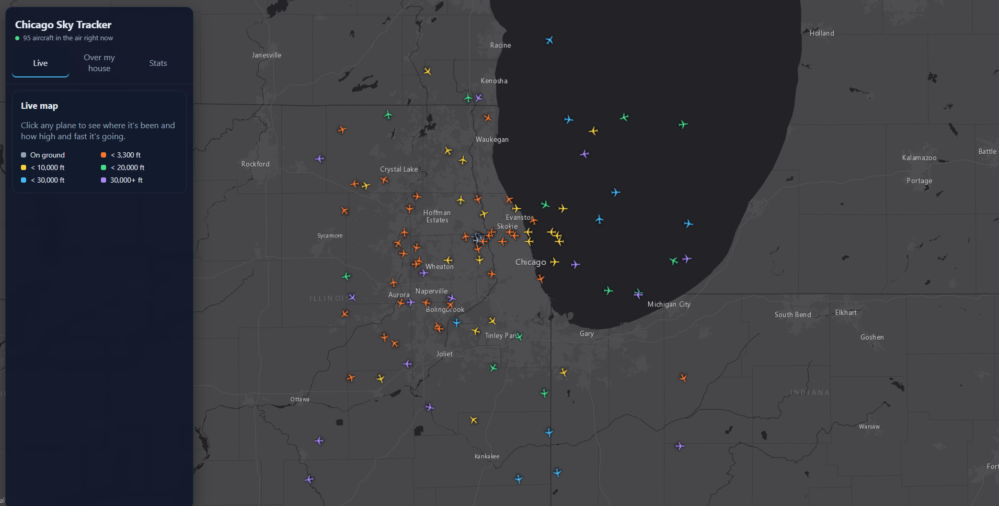

# Chicago Sky Tracker

**Live site: https://chicago-sky-tracker.canadacentral.cloudapp.azure.com**



A live map of every aircraft flying over the Chicago area, plus the history to answer questions like
**"what flew over my house today?"** and **"when is O'Hare's airspace busiest?"**

A Java service polls the [OpenSky Network](https://opensky-network.org) API around the clock, saves every
position report to PostgreSQL, and serves search and stats endpoints to a React map.

## Features

- **Live map**: every plane in the area, pointed in the direction it's flying and colored by altitude. Updates every 10 seconds.
- **Flight paths**: click a plane to see its altitude, speed and climb rate, and the route it has flown over the last 6 hours.
- **Over my house**: type an address or click the map to see every aircraft that passed within a chosen radius, with how close and how high each one was.
- **Stats**: total positions recorded, busiest hours of the day, and top airlines.

## How it works

```
OpenSky API ──► Java poller (Spring Boot, scheduled) ──► PostgreSQL ──► REST API ──► React + Leaflet map
```

- **Data collection**: a scheduled job fetches all aircraft inside the Chicago area. It signs in with OAuth (client credentials), refreshes its token before it expires, and keeps running through rate limits and network errors.
- **Storage**: one row per position report. A unique key on (aircraft, timestamp) means a report that shows up in two polls is only stored once, and each poll is saved as a single batched transaction.
- **Location search**: "within 2 km of this point" uses Postgres's `earthdistance` extension with a GiST index, so it only looks at nearby rows instead of measuring the distance to every stored position.
- **Airline names**: callsigns like `UAL123` are matched to airline names with a regular expression in SQL and a lookup table.
- **Automatic cleanup**: at 30 second polling the app collects about 400,000 positions (~120 MB) a day. A nightly job keeps
  every position for 7 days, thins older data to one position per aircraft every 2 minutes (about 4× smaller), and deletes
  anything older than 90 days. It works one hour of data at a time in short transactions so it never blocks the poller,
  and it saves its progress so a missed night is caught up on the next run. All three windows are configurable.
- **Database changes** are versioned with Flyway migrations (`backend/src/main/resources/db/migration`).

## Tech stack

| Layer    | Tools |
|----------|-------|
| Backend  | Java 25, Spring Boot 4, JDBC, Flyway, Bean Validation |
| Database | PostgreSQL 17 (`earthdistance`, `cube`) |
| Frontend | React 19, TypeScript, Vite, Leaflet |
| Data     | OpenSky Network REST API, OpenStreetMap geocoding |

## API

| Endpoint | What it returns |
|----------|-----------------|
| `GET /api/flights/live` | Latest position of every aircraft currently in the area |
| `GET /api/flights/{icao24}/track?hours=6` | One aircraft's path, oldest first |
| `GET /api/overhead?lat=&lon=&radiusKm=2&hours=24` | Aircraft that passed near a point, at their closest approach |
| `GET /api/stats/summary` | Totals and how long tracking has been running |
| `GET /api/stats/hourly?days=7` | Average number of aircraft per hour of day (Chicago time) |
| `GET /api/stats/airlines?days=7&limit=10` | Airlines ranked by number of aircraft |

## Running it locally

**You'll need:** Java 25, Node 20+, and PostgreSQL 17.

1. Create the database:
   ```
   createdb -U postgres flight_tracker
   ```
2. Set up the backend's settings:
   ```
   cd backend
   cp .env.example .env     # then fill in DB_PASSWORD
   ```
   Optional: create a free API client on OpenSky (Account → API Client), add the ID and secret to `.env`, and set
   `OPENSKY_POLL_INTERVAL=PT30S`. Without an account, the API allows about 400 requests a day, so the app polls every 4 minutes.
3. Start the backend (it creates the tables on first run):
   ```
   ./mvnw spring-boot:run
   ```
4. Start the frontend in a second terminal:
   ```
   cd frontend
   npm install
   npm run dev
   ```
5. Open http://localhost:5180.

### Tests

The tests run against a separate database so they never touch collected data:
```
createdb -U postgres flight_tracker_test
cd backend
./mvnw test
```

## Data credits

Flight data from [The OpenSky Network](https://opensky-network.org). Map tiles © Esri (Esri, HERE, Garmin, © OpenStreetMap contributors).
