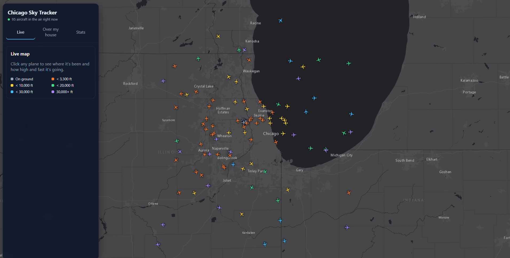

# Chicago Sky Tracker

**Live site: https://chicago-sky-tracker.canadacentral.cloudapp.azure.com**



A live map of every aircraft flying over the Chicago area, plus the history to answer questions like
**"what flew over my house today?"** and **"when is O'Hare's airspace busiest?"**

A Java service polls the [OpenSky Network](https://opensky-network.org) API around the clock, saves every
position report to PostgreSQL, and serves search and stats endpoints to a React map.

## Features

- **Live map**: every plane in the area, colored by altitude, with an icon for its type (heavy jet, airliner, small plane, helicopter). Planes glide smoothly between position reports: the map estimates where each one is from its last speed and heading, and eases into each new report instead of jumping.
- **Flight details**: click a plane to see its altitude, speed, heading, climb rate and squawk code, an altitude and speed chart for the flight so far, and its path colored by altitude. The path only shows the current flight, not the one before it landed. **Follow** keeps the map centered on it.
- **Search**: find a flight by callsign, airline, transponder code or squawk, or jump to an airport.
- **Airport boards**: click O'Hare, Midway or one of the smaller airports for live lists of planes arriving, departing and on the ground. There's no flight plan data, so planes are sorted by what they're doing: low, descending and pointed at the airport means arriving.
- **Playback**: replay the sky at any moment in the last 90 days, at up to 120× speed, with a timeline to scrub through the day.
- **Emergency alerts**: a plane squawking 7500, 7600 or 7700 turns red, pulses, and gets a banner at the top of the sidebar.
- **Filters**: by altitude, airline, aircraft type and on the ground. Planes that don't match fade out rather than disappear. Also: callsign labels, and dark, light or satellite maps. Settings are remembered.
- **Shareable links**: the address bar always describes what's on screen (`?flight=a1b2c3&t=2026-10-24T20:30:00Z`), so a flight, an airport or a moment in playback can be sent as a link.
- **Over my house**: type an address or click the map to see every aircraft that passed within a chosen radius, with how close and how high each one was.
- **Stats**: total positions recorded, busiest hours of the day, and top airlines.

## How it works

```
OpenSky API ──► Java poller (Spring Boot, scheduled) ──► PostgreSQL ──► REST API ──► React + Leaflet map
```

- **Data collection**: a scheduled job fetches all aircraft inside the Chicago area. It signs in with OAuth (client credentials), refreshes its token before it expires, and keeps running through rate limits and network errors.
- **Storage**: one row per position report. A unique key on (aircraft, timestamp) means a report that shows up in two polls is only stored once, and each poll is saved as a single batched transaction.
- **Location search**: "within 2 km of this point" uses Postgres's `earthdistance` extension with a GiST index, so it only looks at nearby rows instead of measuring the distance to every stored position.
- **Playback**: "where was every plane at 3:30 PM on Oct 24" is each aircraft's latest position in the 90 seconds before
  that moment (`DISTINCT ON` over the time index). Data older than 7 days has been thinned to one position every 2 minutes,
  so for those dates the window widens to match. The browser replays by moving its own clock and fetching a new snapshot
  every 30 seconds of replayed time.
- **Smooth map**: a couple of hundred planes moving every frame would mean a lot of React re-rendering, so the plane layer
  manages Leaflet markers directly and moves them in an animation loop, only rebuilding a plane's icon when its look changes.
- **Airline names**: callsigns like `UAL123` are matched to airline names with a regular expression in SQL and a lookup table.
- **Automatic cleanup**: at 30 second polling the app collects about 400,000 positions (~120 MB) a day. A nightly job keeps
  every position for 7 days, thins older data to one position per aircraft every 2 minutes (about 4× smaller), and deletes
  anything older than 90 days. It works one hour of data at a time in short transactions so it never blocks the poller,
  and it saves its progress so a missed night is caught up on the next run. All three windows are configurable.
- **Database changes** are versioned with Flyway migrations (`backend/src/main/resources/db/migration`).

## Tech stack

| Layer    | Tools |
|----------|-------|
| Backend  | Java 25, Spring Boot 4, JDBC, Flyway, Bean Validation |
| Database | PostgreSQL 17 (`earthdistance`, `cube`) |
| Frontend | React 19, TypeScript, Vite, Leaflet |
| Data     | OpenSky Network REST API, OpenStreetMap geocoding |

## API

| Endpoint | What it returns |
|----------|-----------------|
| `GET /api/flights/live` | Latest position of every aircraft currently in the area |
| `GET /api/flights/playback?at=2026-10-24T20:30:00Z` | Where every aircraft was at a moment in the past |
| `GET /api/flights/{icao24}/track?hours=6&until=` | One aircraft's path, oldest first, ending now or at `until` |
| `GET /api/overhead?lat=&lon=&radiusKm=2&hours=24` | Aircraft that passed near a point, at their closest approach |
| `GET /api/stats/summary` | Totals and how long tracking has been running |
| `GET /api/stats/hourly?days=7` | Average number of aircraft per hour of day (Chicago time) |
| `GET /api/stats/airlines?days=7&limit=10` | Airlines ranked by number of aircraft |

## Running it locally

**You'll need:** Java 25, Node 20+, and PostgreSQL 17.

1. Create the database:
   ```
   createdb -U postgres flight_tracker
   ```
2. Set up the backend's settings:
   ```
   cd backend
   cp .env.example .env     # then fill in DB_PASSWORD
   ```
   Optional: create a free API client on OpenSky (Account → API Client), add the ID and secret to `.env`, and set
   `OPENSKY_POLL_INTERVAL=PT30S`. Without an account, the API allows about 400 requests a day, so the app polls every 4 minutes.
3. Start the backend (it creates the tables on first run):
   ```
   ./mvnw spring-boot:run
   ```
4. Start the frontend in a second terminal:
   ```
   cd frontend
   npm install
   npm run dev
   ```
5. Open http://localhost:5180.

   To work on the frontend with real data and no backend, point it at the live site:
   `API_TARGET=https://chicago-sky-tracker.canadacentral.cloudapp.azure.com npm run dev`

### Tests

The tests run against a separate database so they never touch collected data:
```
createdb -U postgres flight_tracker_test
cd backend
./mvnw test
```

## Data credits

Flight data from [The OpenSky Network](https://opensky-network.org). Map tiles © Esri (Esri, HERE, Garmin, © OpenStreetMap contributors).
